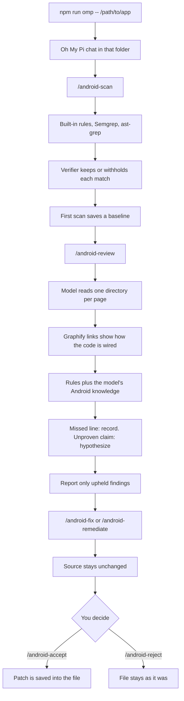
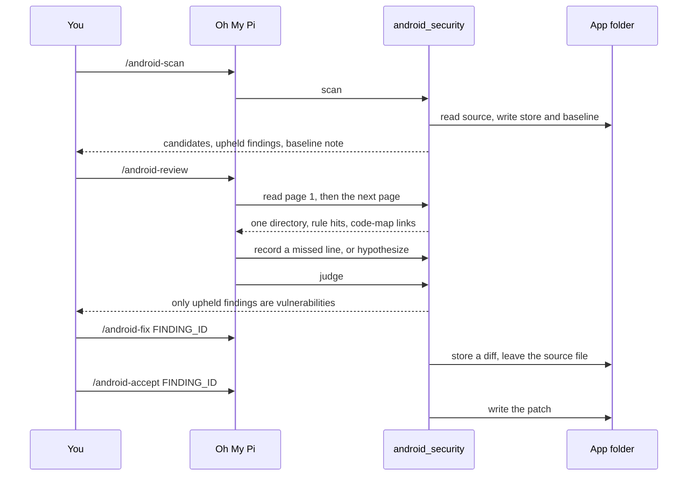
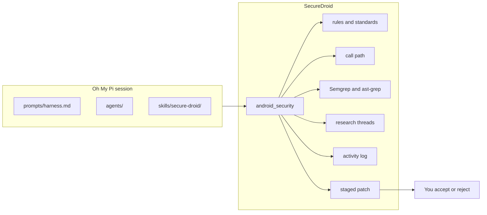

# SecureDroid

SecureDroid is a local Android secure-coding harness. It runs inside [Oh My Pi](https://github.com/can1357/oh-my-pi). The model reads the app. SecureDroid decides which matches are vulnerabilities, keeps the evidence, stages a fix, and writes the source only after you accept.

Repository: [github.com/AhmadAliQureshi147/SecureDroid](https://github.com/AhmadAliQureshi147/SecureDroid)

Android Studio does not need to be open. Point the commands at the project folder on disk.

A model answer is a lead. A rule match is a candidate. A finding is called a vulnerability only after the verifier upholds it. An empty scan does not mean the app meets OWASP MASVS. `partial` verification means the insecure pattern is gone from the file and the app was not compiled or launched.

## How a session works



The chat does not print findings by itself. `/android-scan` prints them. `/android-review` is when the model reads the source.

## What you need

- Node.js 22.18 or newer
- Git
- [Bun](https://bun.sh), because Oh My Pi runs on Bun
- An app folder with `AndroidManifest.xml` and Gradle, `pubspec.yaml` for Flutter, or `package.json` for React Native

Optional:

- Semgrep, on `PATH` or at `.tools/venv/bin/semgrep`
- The `graphify` command, from `uv tool install graphifyy`, for the local code map
- A Cursor API key in `.env` if you want Oh My Pi to use the Cursor provider. The review brain named by this project is Grok 4.7 (`grok-4.7-high-fast`). Choose that model in the Oh My Pi model list.

## Setup

```bash
git clone https://github.com/AhmadAliQureshi147/SecureDroid.git
cd SecureDroid
git clone --depth 1 https://github.com/can1357/oh-my-pi.git oh-my-pi
cd oh-my-pi && bun install && cd ..
npm install
cp .env.example .env
```

Put the Cursor key in `.env` as `CURSOR_API_KEY`. That file is gitignored. Do not commit it.

On Windows, use **Git Bash** for `npm run omp`. PowerShell can run the `node` scan commands below. Android Studio does not need to be open.

```bash
npm run omp -- /c/Users/you/AndroidStudioProjects/YourApp
```

## Start a review

```bash
npm run omp -- /path/to/your-android-project
```

The first lines are the npm script. The terminal then becomes the Oh My Pi chat, sitting in that app folder. Type:

```text
/android-scan
/android-review
```

The planted sample is:

```bash
npm run omp -- fixtures/native-android
```

A scan without the chat:

```bash
node --experimental-strip-types src/cli.ts scan /path/to/android-app
```

Findings live in `<app>/.secure-droid/store.json`. Research threads live in `<app>/.secure-droid/research.json`. The activity log is `<app>/.secure-droid/activity.jsonl`. The baseline is `<app>/.secure-droid/baseline.json`.

## Review flow



On each source page the model is told to learn what that directory does, then judge every line. Lines the rules already recorded are left alone. A line the rules missed is recorded on that file and line, then the model continues. A fix is staged only when the same screen, data, and user step still work. If the safe change would remove a feature, it stays a recommendation.

## Commands

Inside the chat, type the slash command. The same action exists on the command line as `node --experimental-strip-types src/cli.ts <command>`.

| Command | Purpose | Writes the app? |
|---|---|---|
| `/android-detect` | Name the frameworks, languages, and which scanners are installed. | No |
| `/android-map` | List launcher and exported entry points. | No |
| `/android-scan` | Run the rules and scanners, triage the matches, and save or compare the baseline. | Store only |
| `/android-review` | Ask the model to read every directory and investigate. | Store only |
| `/android-triage` | Show which stored findings the verifier still upholds. | Store only |
| `/android-findings` | Print the stored findings. | No |
| `/android-investigate <id>` | Show the evidence, runtime label, and recommendation for one finding. | No |
| `/android-fix <id>` | Stage one patch. The source file stays as it is. | Store only |
| `/android-remediate` | Stage every automatic patch. Manual findings stay recommendations. | Store only |
| `/android-verify <id>` | Re-check a staged patch. `partial` is not a pass. | No |
| `/android-accept <id>` | Save a staged patch that is not blocked, and only if the file still matches the scanned bytes. | Yes |
| `/android-reject <id>` | Throw away the staged patch. | No |
| `/android-except <id> <reason>` | Suppress this exact evidence fingerprint. A later edit of that evidence opens it again. | Store only |
| `/android-threads` | List research threads: question and status, not the evidence body. | No |
| `/android-thread <thr-id>` | Open one research thread. | No |
| `/android-activity` | Count which harness actions ran. This is not proof of a vulnerability. | No |
| `/android-baseline` | Replace the comparison point with the current open findings. | Store only |

The model records an extra line with the `record` action and an unproven claim with `hypothesize`. Those are tool actions. They are not slash commands. A recorded line stays medium confidence and cannot be `P0`. A hypothesis is not a finding.

Command-line examples:

```bash
node --experimental-strip-types src/cli.ts detect /path/to/android-app
node --experimental-strip-types src/cli.ts scan /path/to/android-app
node --experimental-strip-types src/cli.ts threads /path/to/android-app
node --experimental-strip-types src/cli.ts thread thr-001 /path/to/android-app
node --experimental-strip-types src/cli.ts activity /path/to/android-app
node --experimental-strip-types src/cli.ts remediate /path/to/android-app
node --experimental-strip-types src/cli.ts fix <finding-id> /path/to/android-app
node --experimental-strip-types src/cli.ts accept <finding-id> /path/to/android-app
node --experimental-strip-types src/cli.ts reject <finding-id> /path/to/android-app
```

## What each part is for



| Piece | Role |
|---|---|
| `prompts/harness.md` | Standing rules for the model: read every directory, keep features, do not edit source. |
| `agents/` | Specialist roles. None of them accept a patch. The fixer only stages. |
| `skills/secure-droid/` | Repeatable procedure for Kotlin, Compose, Flutter, React Native, fixes, and review. |
| `src/rules.ts` | Deterministic insecure-coding checks. |
| `src/standards.ts` | Maps a rule to an OWASP MASVS v2 id, and lists requirements that are not default findings. |
| `src/runtime.ts` | Labels a finding `runtime-reachable`, `runtime-conditional`, or `build-time` from a source call path. |
| `src/engines.ts` | Keeps a Semgrep or ast-grep hit only when the line still shows the pattern. |
| `src/source.ts` | One directory per page, with the rule hits for that page and the code-map links. |
| `src/graphify.ts` | Local call and import map. Extracted means read those files. Inferred stays unconfirmed. |
| `src/harness.ts` | Research threads, the activity log, and the scan baseline. |
| `src/triage.ts` | Upholds, withholds, or rejects. The model cannot dismiss a live rule match. |
| `src/patch.ts` | Builds the diff and blocks a patch that weakens a control. |
| `src/guard.ts` | Blocks a session edit that adds a trust-all check, an allow-all hostname verifier, an ignored TLS error, a world-readable mode, or universal WebView file access. |
| `src/store.ts` | Saves findings, exceptions, and staged diffs under `.secure-droid/`. |

## Languages

The read covers Kotlin, Java, C, C++, C#, Dart, JavaScript, TypeScript, Python, Rust, Ruby, Lua, HTML, CSS, Groovy, Gradle Kotlin DSL, and XML.

The sharpest rules cover the usual Android families: trust-all TLS, obsolete TLS, cleartext, WebView file access and bridges, safe browsing turned off, PendingIntent mutability, unsafe `Intent.parseUri`, exported components, world-readable files, FileProvider root paths, `sharedUserId`, `allowTaskReparenting`, dex class loaders, `CONTEXT_IGNORE_SECURITY`, `CONTEXT_INCLUDE_CODE`, `System.load`, a fixed `SecureRandom` seed, `Cipher.getInstance("AES")`, HTTP body logging, SQL or commands built from external text, deserialization, zip paths, hardcoded keys, and secrets in logs, the clipboard, preferences, or external storage.

C, C++, C#, Python, Rust, Ruby, and Lua have a smaller set: unbounded native copies, `system` and `popen`, a .NET handler that returns true for every certificate, Python `verify=False` and `pickle.loads`, Rust `danger_accept_invalid_certs(true)`, Ruby `VERIFY_NONE`, and Lua `os.execute` or `loadstring`. HTML, CSS, and Groovy are read so the model can judge them. A line the rules miss can still be recorded.

These are not findings by themselves: the launcher activity, JavaScript enabled on a WebView, and ordinary Compose state.

## Automatic patches

`/android-remediate` stages these and does not accept them:

- `MODE_WORLD_READABLE` and `MODE_WORLD_WRITEABLE` become `MODE_PRIVATE`
- release `debuggable` is turned off, and `android:debuggable="true"` is turned off on that line
- `android:allowBackup="true"` becomes `false` on that line
- `FLAG_IMMUTABLE` is added on the same line as a `PendingIntent` factory call
- cleartext is turned off on the finding line
- `setWebContentsDebuggingEnabled(true)` becomes `false`
- `MIXED_CONTENT_ALWAYS_ALLOW` becomes `MIXED_CONTENT_NEVER_ALLOW`

Crypto, secrets, WebView bridges, and exported components stay recommendations.

## Verification

| Status | Meaning |
|---|---|
| `not-run` | There is no source patch, or the check did not run. |
| `partial` | The pattern is gone, the delimiters balance, and the app was not built or run. |
| `failed` | The patch broke the delimiters, or the original pattern is still there. |
| `blocked` | The patch is stale, unsafe, or would weaken a control. |
| `passed` | Not used. The build and the app are not run. |

`partial` is not a pass. SecureDroid does not run Gradle, Android Lint, or the project tests, because those commands execute repository code.

## Standards

The `masvs` field names the MASVS v2 requirement a check relates to. Covered areas include storage, cryptography, network, platform IPC, WebView, input validation, backup and log leakage, clipboard disclosure, and debuggable release builds.

These are investigated, not reported from a pattern alone:

- Authentication and step-up (`MASVS-AUTH-1` through `MASVS-AUTH-3`)
- Certificate pinning (`MASVS-NETWORK-2`)
- Minimum SDK and forced updates (`MASVS-CODE-1` and `MASVS-CODE-2`). Dependency versions use the local OSV snapshot (`MASVS-CODE-3`). A package missing from that snapshot is not a pass.
- Tamper checks and obfuscation (`MASVS-RESILIENCE-1` through `MASVS-RESILIENCE-3`)
- Privacy notices and user control (`MASVS-PRIVACY-2` through `MASVS-PRIVACY-4`)

## Tests

```bash
npm test
```

`fixtures/` holds planted vulnerabilities and safe counterparts. The clean fixture must not produce a `P0`, `P1`, or `P2` finding.

## Limits

SecureDroid does not discover every vulnerability and it does not replace a penetration test. The advisory check is one local OSV snapshot, not every published advisory. There is no CI gate, dashboard, or hosted model. The Oh My Pi provider you configure handles model traffic. The code map does not decide a vulnerability and does not edit source.
